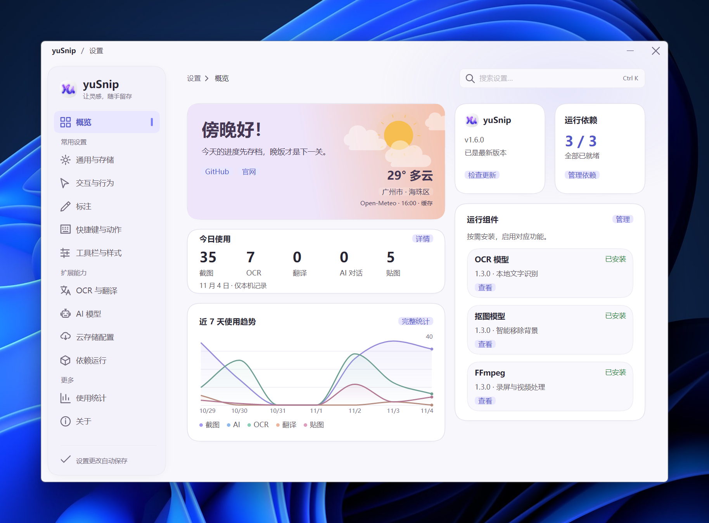
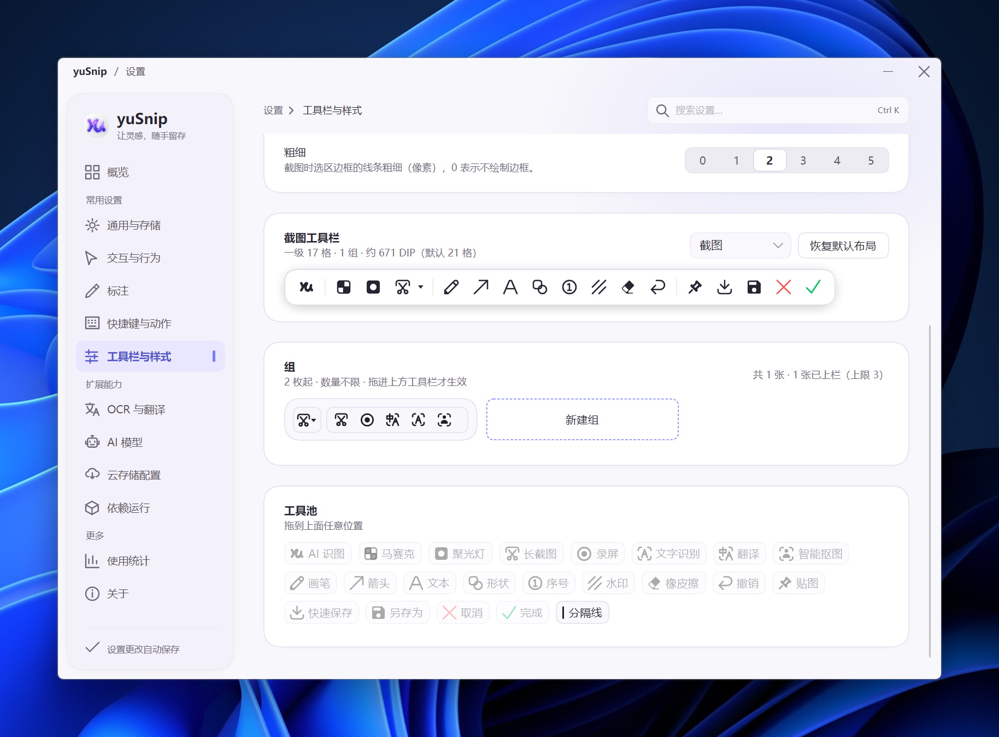
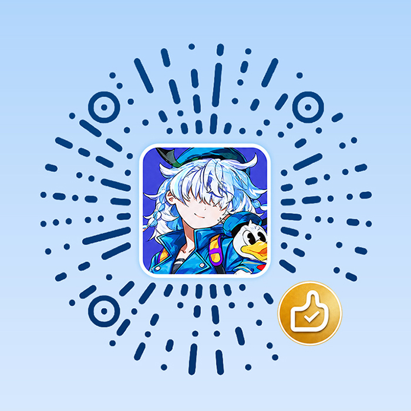

# yuSnip

**Take a screenshot, draw a circle, write a line. Leave your ideas on the image.**

[简体中文](README.md) · **English**

yuSnip is a free, open-source screenshot, pinning and screen recording tool for Windows, built from a designer's perspective. It is for people who use screenshots to write tutorials, document bugs or keep a design reference in view. After selecting an area, you can annotate it, extract its text, record it or pin the result for further work. Developers can build the application from source or integrate capture, OCR and pinning into their own workflows.

[Download yuSnip](https://github.com/yusnip/yuSnip/releases/latest) · [Official website](https://yusnip.top/) · **[User guide (Chinese)](USER_GUIDE.md)** · [Changelog](更新记录.txt) · [Build from source](#build-from-source) · [Report an issue](https://github.com/yusnip/yuSnip/issues)

Supports Windows 10 version 2004 (build 19041) or later and Windows 11 on x64.

Download `yuSnip.exe` from the Assets section of the GitHub Release.

## Interface and interaction

### Capture interface

The magnifier follows the cursor as you frame the image. Once you select an area, its size, corners, border and shadow controls stay by the selection. Annotation tools sit along its lower edge, close to the image you are working on.

<details>
<summary>Show the capture demo (GIF, about 22 MB)</summary>


</details>

### Settings interface

The overview and toolbar editor share the same navigation, search and muted violet palette. Select either image to see it at full size.

| Overview | Toolbars and styles |
| --- | --- |
| [](assets/showcase/settings-overview.png) | [](assets/showcase/settings-toolbar.png) |
| Usage trends and component status are visible as soon as you open settings. | The preview, groups and available tools each have a place, so you can see the current layout as you rearrange it. |

[Settings reference](USER_GUIDE.md#sec-13)

## Quick start

Download and run `yuSnip.exe`, then look for yuSnip in the system tray. Right-click the tray icon for capture, history and settings. Try capturing a reference image, adding an arrow, then copying or pinning the result.

| Default shortcut | Action |
| --- | --- |
| `Ctrl+Alt+A` | Start an area capture |
| `F3` | Pin an image or text from the clipboard |
| `Ctrl+Alt+O` | Capture and recognize text |
| `Ctrl+Alt+F` | Translate a captured area and pin the result |
| `Shift+F3` | Show or hide all pins |

Change bindings under Settings → Shortcuts and Actions (「快捷键与动作」). For OCR, background removal or recording features that need extra components, use Settings → Runtime Components (「依赖运行」). [Quick-start guide](USER_GUIDE.md#sec-01) · [Troubleshooting](USER_GUIDE.md#sec-15)

## What you can do with yuSnip

### Finish your annotations before sending a screenshot

Snap to a window or an interface element such as a button, or outline an irregular shape with the pen. The magnifier and one-pixel keyboard adjustments help with thin edges, and you can restore a previous selection when capturing the same area again.

Add arrows and step numbers for a walkthrough, use a spotlight to guide attention, or pixelate details before sharing a bug report. Existing annotations can be selected, moved and undone. Copy, save or pin the finished result. [Capture](USER_GUIDE.md#sec-02) · [Annotation](USER_GUIDE.md#sec-03)

### Capture a long page or a wide table from the middle

Capture tall web pages vertically or wide spreadsheets and timelines horizontally. Scroll manually or automatically and watch the stitched preview grow. If you start in the middle, you can extend both ends or trim away what you captured in excess. yuSnip tries to keep one copy of repeated fixed areas such as headers or sidebars. Copy, save or pin the finished image. [Scrolling capture](USER_GUIDE.md#sec-09)

### Keep a reference on screen and continue working with it

Pin screenshots, clipboard content and images from history above other windows. Lower a pin's opacity and enable click-through to compare a design while interacting with the window beneath it. Select a pin and press `Space` to annotate it later. Several images can share one canvas while remaining independently movable and scalable. Open pins can be restored after a normal restart. [Pins and the multi-image canvas](USER_GUIDE.md#sec-05)

### Copy words directly from an image or edit a full page of text

Hold `Alt` and drag across the words you need on a pinned image. For a full page, use the OCR window to compare recognized lines with the source, reorder them, correct mistakes and export the result. OCR and portrait or general-purpose background removal run locally after their components are installed. [OCR](USER_GUIDE.md#sec-06) · [Background removal](USER_GUIDE.md#sec-matting)

### Record the steps that trigger a problem

Record just the area you need to demonstrate. Pause and resume a take, show clicks and keystrokes, or annotate while recording. System and microphone audio can be controlled independently, and MP4 can keep separate tracks for editing. Preview the recording, then export MP4 or GIF. [Recording and export](USER_GUIDE.md#sec-record)

### Give a repeated workflow its own shortcut

Arrange the toolbars for capture, pinning, scrolling capture and recording. A custom action can capture an area once, pin the original image and copy its recognized text. With capture history enabled, find old screenshots by time or by text recognized in them.

You can translate a screenshot to text or an image, or configure an AI service to ask questions about a captured interface, chart or error. Translation, AI and cloud sync send relevant content to the service you configure when used. [Shortcuts and actions](USER_GUIDE.md#sec-11) · [Capture history](USER_GUIDE.md#sec-10) · [Translation](USER_GUIDE.md#sec-07)

## Build from source

yuSnip uses .NET 10 and Avalonia. Download or clone this repository, install the .NET 10 SDK on Windows x64 and run the public build script from the repository root. [build.ps1](build.ps1) · [SDK version](src/global.json)

```powershell
powershell -NoProfile -ExecutionPolicy Bypass -File .\build.ps1
```

The development build goes to `dist/debug/`. Start `yuSnip.exe` from that folder with its dependency files alongside it. For NativeAOT, install the Desktop development with C++ workload and the Windows SDK using Visual Studio or Build Tools, then append `-NativeAot` to the command. The output goes to `dist/win-x64/`.

### Source layout

| Project | Where to start |
| --- | --- |
| [ScreenCaptureTool](src/ScreenCaptureTool/) | Desktop application, windows and interactions |
| [ScreenCaptureTool.Core](src/ScreenCaptureTool.Core/) | Capture processing, OCR, background removal, recording and core features |
| [ScreenCaptureTool.LongScroll](src/ScreenCaptureTool.LongScroll/) | Scrolling capture, stitching and preview |
| [ScreenCaptureTool.Platform](src/ScreenCaptureTool.Platform/) | Windows APIs and platform interop |
| [ScreenCaptureTool.Ocr](src/ScreenCaptureTool.Ocr/) | Optional Windows OCR verification project |

Open [ScreenCaptureTool.sln](src/ScreenCaptureTool.sln) to browse the solution.

### Call yuSnip from a script

The command line can trigger a configured action. This example starts the action named 「区域截图」 (Area Capture). Use the exact name in your action list, or copy the command from the action editor. [Scripting and automation](USER_GUIDE.md#sec-12)

```powershell
.\yuSnip.exe -a "区域截图"
```

## Feedback and contributions

Bug reports, feature requests and pull requests are welcome. Redact private information before sharing screenshots or logs. [Open an issue](https://github.com/yusnip/yuSnip/issues/new/choose) · [Contributing](CONTRIBUTING.md) · [Private security reporting](SECURITY.md)

[Usage statistics and privacy (Chinese)](USER_GUIDE.md#sec-13-h6)

## Technology stack and acknowledgments

| Feature | Main components |
| --- | --- |
| Desktop UI | **.NET 10, Avalonia UI, and SkiaSharp** provide the runtime, UI framework, and graphics rendering. |
| Offline OCR | **ONNX Runtime** runs **PaddleOCR PP-OCRv6 small** text detection and recognition models locally. |
| Background removal | **U²-NetP** segments general subjects, and **MODNet** handles portrait matting. |
| Scrolling capture | **OpenCV / OpenCvSharp** match scrolling frames and stitch them together. |
| Screen recording and export | **Windows Media Foundation** is the default recording backend. **FFmpeg** powers an optional recording backend, animated WebP export, and some transcoding. |

## License

yuSnip is maintained by 北京林或西. Its own source code is available under the MIT License, which allows use, modification and redistribution, including commercial use, with the copyright and license notices retained. Third-party libraries, models and components keep their own licenses. [MIT License](LICENSE) · [Third-party licenses](src/ScreenCaptureTool/Assets/ThirdParty/)

## Support yuSnip

If yuSnip has become part of your daily routine for capturing, marking up or extracting text from screenshots, you're welcome to buy me a coffee. Your support helps me refine the interface and fix bugs. yuSnip is free to use, and donations are optional.

**Support via WeChat** · Scan the code below in WeChat. Click the image to view it at full size.

<a href="src/ScreenCaptureTool/Assets/WeChatAppreciation.jpg"></a>
