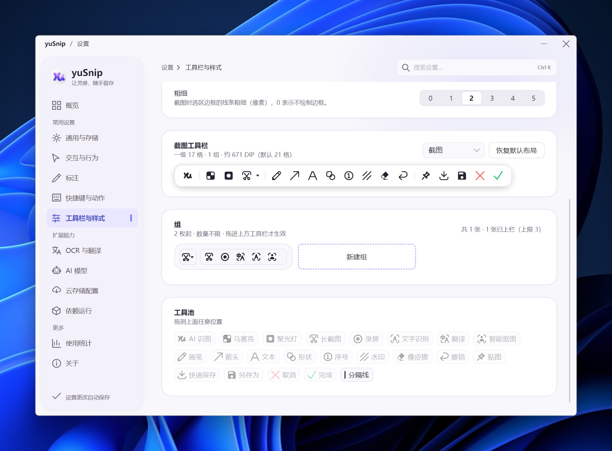

# yuSnip

**截一张图，画一个圈，写一句话——把想法留在画面上。**

**简体中文** · [English](README.en.md)

yuSnip 是一款从设计师视角打磨的免费开源 Windows 截图、贴图与录屏工具。它适合经常用截图写教程、记录问题或对照设计稿的人。框选之后，你可以直接标注、取字、录屏，也可以把结果钉在屏幕上接着用。开发者可以从源码构建，或把截图、OCR 和贴图接进自己的自动化流程。

[下载 yuSnip](https://github.com/yusnip/yuSnip/releases/latest) · [官方网站](https://yusnip.top/) · **[用户文档](USER_GUIDE.md)** · [更新记录](CHANGELOG.md) · [源码构建](#从源码构建) · [问题反馈](https://github.com/yusnip/yuSnip/issues)

支持 Windows 10 版本 2004（内部版本 19041）及以上和 Windows 11 x64。

## 界面与交互

### 截图界面

框选时，放大镜跟着光标走。选区确认后，尺寸、圆角、描边和阴影就在框边调，标注工具紧贴选区下沿，方便一边看画面一边操作。

<details>
<summary>展开截图操作演示（GIF，约 22 MB）</summary>


</details>

### 设置界面

概览和工具栏编辑用同一套侧栏导航、搜索和紫灰配色。点图可看完整尺寸。

| 概览 | 工具栏与样式 |
| --- | --- |
| [](assets/showcase/settings-overview.png) | [](assets/showcase/settings-toolbar.png) |
| 使用趋势和组件状态集中在一页，打开设置就能看到。 | 预览、分组和工具池分开排列，拖动调整时能对照当前布局。 |

[查看设置说明](USER_GUIDE.md#sec-13)

## 快速上手

下载并运行 `yuSnip.exe` 后，在任务栏右下角的系统托盘找到 yuSnip。右键托盘图标可进入截图、历史记录和设置。第一次可以截一张参考图，画个箭头，再选「复制」或「贴图」。

| 默认快捷键 | 操作 |
| --- | --- |
| `Ctrl+Alt+A` | 区域截图 |
| `F3` | 把剪贴板图片或文字贴到屏幕上 |
| `Ctrl+Alt+O` | 截图并识别文字 |
| `Ctrl+Alt+F` | 截图翻译并贴到屏幕上 |
| `Shift+F3` | 显示或隐藏全部贴图 |

快捷键可在「设置 → 快捷键与动作」修改。第一次用 OCR、抠图或部分录屏功能时，可在「设置 → 依赖运行」安装所需组件。 [快速入门](USER_GUIDE.md#sec-01) · [常见问题](USER_GUIDE.md#sec-15)

## 使用场景

### 截图后直接做完标注

截一个弹窗或按钮时，可以让选框吸附到窗口或界面元素。遇到不规则轮廓，可以用钢笔圈出；需要对齐细边时，可以用放大镜和方向键逐像素调整。反复截同一处，还可以恢复上次选区的位置和大小。

做教程时，在图上画箭头、加步骤序号，用聚光灯标出当前区域；做工单配图时，用马赛克或模糊遮盖不宜分享的内容。已有标注可以回选、移动和撤销。成品可以直接复制、保存或贴图。 [截图](USER_GUIDE.md#sec-02) · [标注](USER_GUIDE.md#sec-03)

### 横向和纵向长截图都能从中间开始

竖向可截网页和长列表，横向可截宽表格或时间线。手动或自动滚动时，可以边截边看全景预览。起点选在中间，可以向两头补齐；内容截多了，可以裁掉首尾。遇到反复出现的页眉或侧栏，拼接会尝试在成图里只保留一份。长图完成后也可以直接贴到屏幕上。 [长截图](USER_GUIDE.md#sec-09)

### 把参考图留在屏幕上继续用

截图、剪贴板内容和历史图片都能贴在其他窗口上方。对照设计稿时，可以降低不透明度并打开鼠标穿透，直接操作下方窗口。需要补说明时，选中贴图按 `Space` 进入标注。还可以把多张图片合到同一画布，各自移动和缩放，适合并排放改动前后的画面。正常退出后重新打开 yuSnip，活跃贴图可以随会话恢复。 [贴图与画布](USER_GUIDE.md#sec-05)

### 在图片上选字，也能整理整页识别结果

图片贴在桌面上时，按住 `Alt` 拖选，就能只复制想要的几字。处理整页截图时，可以在 OCR 窗口对照原图定位识别结果，调整行顺序、改错字、清理多余字符，再复制或导出文本。人像和通用抠图也在本机处理，结果可以带透明背景继续贴图或复制。 [OCR](USER_GUIDE.md#sec-06) · [智能抠图](USER_GUIDE.md#sec-matting)

### 录下一个问题是怎么发生的

框住需要演示的区域再录屏，可以暂停和继续，也可以显示鼠标点击效果、按键提示，或在录制过程中加标注。系统声音和麦克风可以独立控制，MP4 可保留分离音轨供后期剪辑。结束后先预览，再导出 MP4 或 GIF。 [录屏与导出](USER_GUIDE.md#sec-record)

### 把高频操作做成一个快捷动作

可以分别调整截图、贴图、长截图和录屏的工具栏。经常摘录资料时，可以设一个动作，框选一次就把原图贴到屏幕上，同时把识别的文字复制到剪贴板。开了截图历史后，还可以按时间或图里的文字找回旧截图。

截图可输出文字译文或译文图片。也可以配置 AI 服务，对截图里的错误提示、图表或界面继续提问。翻译、AI 和云同步属于按需使用的联网功能，相关内容会按你的配置发送给所选服务。 [快捷键与动作](USER_GUIDE.md#sec-11) · [截图历史](USER_GUIDE.md#sec-10) · [翻译](USER_GUIDE.md#sec-07)

## 从源码构建

项目使用 .NET 10 与 Avalonia。下载或克隆仓库后，在 Windows x64 安装 .NET 10 SDK，从仓库根目录执行。 [build.ps1](build.ps1) · [SDK 版本](01_源码/global.json)

```powershell
powershell -NoProfile -ExecutionPolicy Bypass -File .\build.ps1
```

开发构建输出到 `artifacts/debug/`。从该目录启动 `yuSnip.exe`，并保留同目录的依赖文件。需要 NativeAOT 时，先安装 Visual Studio 或 Build Tools 的「使用 C++ 的桌面开发」工作负载和 Windows SDK，再在命令末尾加 `-NativeAot`。输出在 `artifacts/win-x64/`。

### 源码导航

| 项目 | 从这里找什么 |
| --- | --- |
| [ScreenCaptureTool](01_源码/ScreenCaptureTool/) | 桌面应用、窗口与交互 |
| [ScreenCaptureTool.Core](01_源码/ScreenCaptureTool.Core/) | 截图处理、OCR、抠图、录屏和其他核心功能 |
| [ScreenCaptureTool.LongScroll](01_源码/ScreenCaptureTool.LongScroll/) | 长截图采集、拼接和预览 |
| [ScreenCaptureTool.Platform](01_源码/ScreenCaptureTool.Platform/) | Windows API 与平台互操作 |
| [ScreenCaptureTool.Ocr](01_源码/ScreenCaptureTool.Ocr/) | 可选的 Windows OCR 验证入口 |

完整解决方案位于 [ScreenCaptureTool.sln](01_源码/ScreenCaptureTool.sln)。

### 在脚本中调用

可以从命令行触发已配置的动作。下面的命令启动名为「区域截图」的动作，动作名称须与本机列表一致。也可以从动作编辑器复制对应命令。 [脚本与自动化](USER_GUIDE.md#sec-12)

```powershell
.\yuSnip.exe -a "区域截图"
```

## 反馈与贡献

欢迎提 Issue 或 Pull Request。报告问题时请附上 yuSnip 版本、Windows 版本和复现步骤，分享截图或日志前请遮盖私人信息。安全漏洞请通过私下渠道报告。 [Issues](https://github.com/yusnip/yuSnip/issues) · [安全报告](SECURITY.md)

## 开源许可

yuSnip 由北京林或西维护。自有源码采用 MIT 许可，可使用、修改、分发和商用，分发时须保留版权与许可声明。第三方库、模型和组件各自遵循其许可。 [MIT 许可证](LICENSE) · [第三方许可](01_源码/ScreenCaptureTool/Assets/ThirdParty/)

## 支持 yuSnip

如果 yuSnip 已经成了你日常截图、标注或提取文字的顺手工具，欢迎请我喝杯咖啡。你的赞赏支持我继续打磨界面和交互、修复问题。yuSnip 免费使用，赞赏随心。

**微信赞赏** · 用微信「扫一扫」识别下方赞赏码。点击图片可查看原图。

<a href="01_源码/ScreenCaptureTool/Assets/WeChatAppreciation.jpg"></a>
